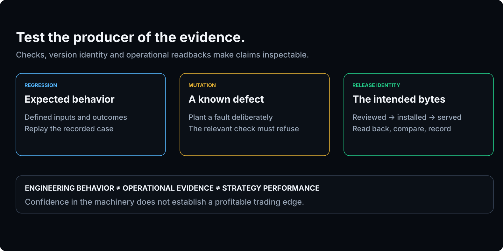

# NP Command Center

### AI-directed engineering. Evidence before claims.

> The goal isn't to get more answers out of AI. It's to build a system that knows when an answer has earned the right to be trusted.

I'm Nilesh Patel. I build **NP Command Center** independently: an engineering and research platform where AI agents build, test and operate a quantitative-research stack under written governance. No claim moves forward on anyone's say-so, whether it comes from a backtest, a model, an agent or me. It has to survive preregistered statistical tests, reproducible evidence and independent review first. Execution is **paper-only** and kept apart from research.

<p align="center">
  
</p>

---

## What I'm building

NP Command Center is a single-operator platform for **AI-directed engineering and quantitative research**, applied to US equities and options market data. It covers two things:

- **The research machine.** It generates hypotheses at scale, then tries to kill them with deflated statistics, multiple-testing control, purged cross-validation and sealed forward holdouts.
- **The engineering machine.** It ships the platform itself, using AI coding agents that work under contracts, mutation-tested guards, gated deploys and release verification.

The interesting problem isn't the trading. It's **how far AI-produced work can be trusted**, and what an operating system needs to look like to answer that honestly.

## What makes it different

| | |
|---|---|
| **Autonomous agents, bounded authority** | AI agents do the engineering. Privileged decisions (credentials, capital, statistical bars) stay with the owner or an independent reviewer, and every ruling is recorded. |
| **Evidence chains** | A result is tied to the commit, the sealed inputs and the digests that produced it, so it can be replayed instead of believed. |
| **Adversarial review** | Plans and findings go to independent review before they're built or credited. Reviewers corroborate; they never become a second source of authority. |
| **Reproducible testing** | Red-first tests, sealed golden fixtures, and mutation tests that prove each guard fails when the thing it protects breaks. |
| **Governed promotion** | Research may propose. Only proof may promote. A candidate has to clear every gate, then a preregistered forward window. |
| **Fail-closed behaviour** | Unparseable input, coverage gaps and stale data produce *refusal*, never a quiet default. |
| **Discovery ≠ evidence** | The data that suggested a hypothesis can never confirm it. Discovery samples are spent; confirmation comes from data the search never saw. |

## Architecture

```
 AI agents ─────────────── build · test · operate, under written governance
     │
     ▼
 Signal Foundry ────────── hypothesis sweeps over historical market data
     │
     ▼
 Adversarial validation ── N_eff floor · BH-FDR · purged CV / walk-forward · Deflated Sharpe · PBO
     │
     ▼
 Research objects ──────── preregistered · sealed · forward-tested on data the search never saw
     │
     ▼
 Promotion vault ───────── independent review + owner ruling            (currently: 0 certified)
     ┊
     ┊  trust firewall: nothing reaches execution unless it has been promoted
     ▼
 Runtime plane ─────────── market data → cloud pipeline → role-gated database →
                           deterministic, fail-closed decision engine →
                           route-only execution service → paper account

 Across both planes: issue & decision registers · gated deploys · release read-back · observability
```

## Major systems

- **NP Command Center (platform & operator console).** The web applications, QA harnesses, deploy tooling, the issue register and the decision register.
- **Signal Foundry.** The research engine. It runs hypothesis sweeps, a battery of validation statistics and a sealed golden corpus, and keeps holdout data apart from discovery.
- **ECP (signal intelligence).** The operator's live signal and forecast view. Its forecasts are themselves scored by preregistered forward tests.
- **Research objects.** Each research question is a governed object with a spec, a preregistration, reporting floors and a lifecycle: *proposed → built → live → reporting → retired*.
- **Forward testing & holdouts.** Sealed forward windows that only count until they're allowed to evaluate. Holdout data is captured but left unread until preregistered conditions are met.
- **Execution service.** The only component that talks to a broker. It holds credentials server-side, can only route orders and runs against a **paper** account.
- **Cloud automation & observability.** Scheduled cloud jobs, job-health checks, deploy-currency gates, and read-back verification of what's actually served.

## Engineering principles

- **Evidence before claims.** A bare number isn't a result. Every claim carries its subject, its population, its method and its date.
- **Absence is not zero.** Missing data is reported as missing, never filled in as a neutral value.
- **Fail closed.** If it can't be verified, it doesn't run.
- **Preregister before evaluating.** Hypotheses, metrics and thresholds are sealed before the data is seen.
- **Separate research from production.** Discovery can't route an order.
- **Human authority for privileged actions.** Agents propose and build; owner-held decisions stay with the owner.
- **A guard that can't fail isn't a guard.** Every check has a kill test.
- **Keep negative results.** A failed test stays in the research record.

## Current research position

**As of late October 2026: 17 research objects registered, 0 confirmed edges.** That's not a gap in the story. It's the main result.

The platform has generated and tested millions of candidate hypotheses. Here is some of what the machinery has turned down:

- A 153-configuration search for a trade selector found nothing worth preregistering. The null was accepted, and the ledger frozen for a single future replication.
- A short-side comparison didn't survive false-discovery-rate control. The one comparison that did is treated only as a **discovery candidate, with no credit**, until data it has never seen confirms it.
- A proposed expansion to a new symbol was **rejected after four adversarial reviews**. Its key conditioning variable couldn't be measured intraday, and no sample size fixes a variable you can't measure.
- Two independent searches for high-quality edges found nothing close to the bar.

Three forward tests are sealed now and only count until they reach their floors. **Nothing here is a claim of profitable trading or a production edge.** Execution is paper-only. The platform is designed to stop unsupported claims from reaching production, and so far it has.

## Technology

**Languages:** Python (NumPy, pandas, SciPy) · JavaScript / Node.js<br>
**Infrastructure:** Google Cloud (serverless services and scheduled jobs) · Firebase · Docker<br>
**Markets:** a brokerage API (paper trading) · equity and options market data<br>
**AI:** AI coding agents for engineering · LLMs for narrative synthesis in the data pipeline<br>
**Statistics:** Deflated Sharpe ratio · probability of backtest overfitting · Benjamini–Hochberg FDR · purged & embargoed cross-validation · sealed forward holdouts

## Status

This is an active, independent engineering and research project under daily development. The source is private because it's connected to live brokerage and cloud accounts. No result here should be read as investment performance or advice.

<sub>Method attributions: López de Prado (purged and embargoed validation); Bailey and López de Prado (Deflated Sharpe); Bailey, Borwein, López de Prado and Zhu (probability of backtest overfitting). Implementation and operating controls are my own.</sub>

<sub>Contact: [LinkedIn](https://www.linkedin.com/in/nileshkpatel/)</sub>
